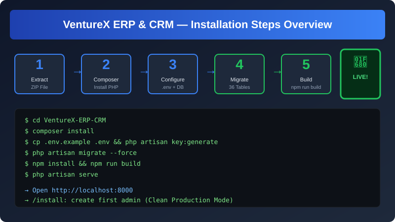
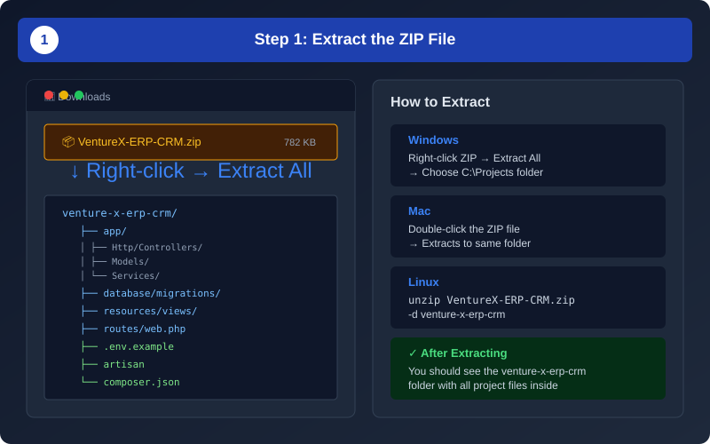
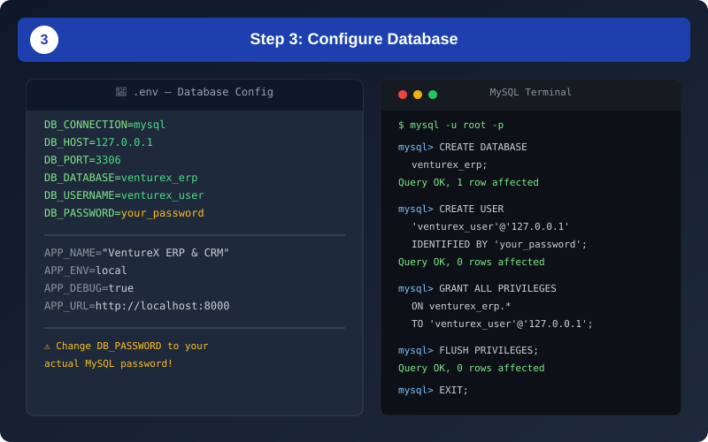
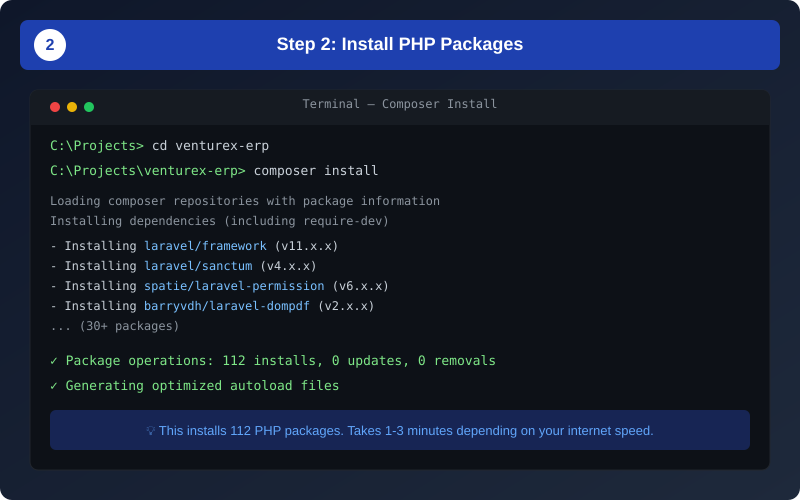
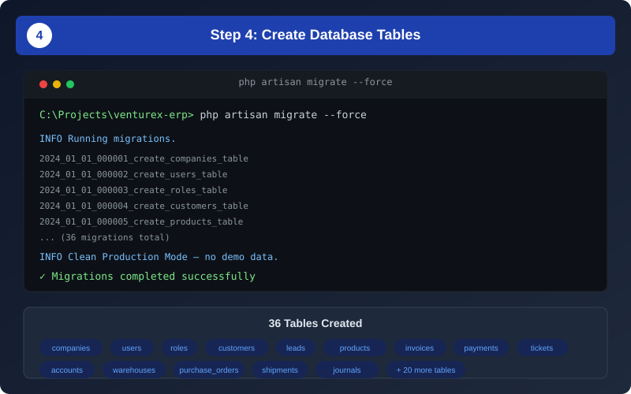

# Installation Guide — VentureX ERP & CRM v1.3.1

**AI-Powered CRM & ERP Business Operating System**

This guide covers local Windows/macOS, Docker, VPS/Ubuntu, cPanel shared hosting and WordPress subdomain deployments. It applies to the v1.3.1 artifact set.

---

## Before you start

### Requirements

| Software | Required version | Notes |
|---|---|---|
| PHP | **8.4** | Required. Older PHP 8.x releases are not supported by v1.3.1. |
| MySQL | **8.0+** | MariaDB 10.6+ also works. |
| Composer | 2.x | PHP dependency manager. |
| Node.js | 20+ | Needed to build CSS/JS. The deploy action provisions Node.js 22. |
| Web server | Apache 2.4+ or Nginx 1.24+ | **Document root MUST be `public/`.** |

Required PHP extensions: `pdo_mysql`, `mbstring`, `xml`, `dom`, `curl`, `zip`, `bcmath`, `gd`, `intl`, `fileinfo`, `tokenizer`, `ctype`, `json`, `openssl`. Redis/opcache are recommended in production.

### Release artifacts

Use the v1.3.1 artifact for your channel, for example:

- `VentureX-ERP-CRM-v1.3.1-source.zip` — generic/local/source install
- `VentureX-ERP-CRM-v1.3.1-cPanel.zip` — cPanel/shared hosting
- `VentureX-ERP-CRM-v1.3.1-Gumroad.zip`, `...-Payhip.zip`, `...-Codester.zip`, `...-Coderobotics.zip`, `...-LemonSqueezy.zip`, `...-SellAnyCode.zip`, `...-ZERO-ERRORS.zip`

Verify downloaded files against [release/SHA256SUMS.txt](../release/SHA256SUMS.txt) when the v1.3.1 checksum manifest has been published. Do not use the obsolete `VentureX-ERP-UPLOAD.zip` name.

### Document root rule

> **The web-visible document root MUST be the project's `public/` directory.** Never point Apache/Nginx at the project root. The root `.htaccess` is a fallback only: it blocks sensitive files and can forward the first request into `public/` when a host refuses a document-root change. `public/.htaccess` is the standard Laravel front controller and is the preferred rewrite layer.

### Installation modes

The one-time wizard at `/install` offers:

- **Clean Production Mode (recommended):** creates the schema, required roles/permissions and the administrator you specify. It does **not** create demo users or sample business records.
- **Demo Preview Mode:** optional sample records for a throwaway local evaluation. Never enable it on a public, shared or client server.

Demo credentials are **LOCAL DEMO ONLY**:

| Role | Email | Password |
|---|---|---|
| Super Admin | `demo_admin@example.com` | `Demo_Admin_2026!` |
| CEO | `demo_manager@example.com` | `Demo_Manager_2026!` |
| Sales Manager | `demo_sales@example.com` | `Demo_Sales_2026!` |

Preview URLs are local only: `http://localhost:8000` and `http://127.0.0.1:8000`. Change or remove demo accounts before production use.

> **Production databases:** use `/install` or `php artisan migrate --force`. Do **not** use `php artisan migrate --seed` in production; the legacy seed command can include demo data. Demo/optional seeders are only for local evaluation.

### Safe `.env` notes

- Copy `.env.example` to `.env` and run `php artisan key:generate`.
- The web installer writes database, mail and URL values with proper escaping. If you edit `.env` manually, quote values containing spaces, `#`, `$`, quotes or backslashes, and keep secrets out of shell history and chat/logs.
- `.env`, `.env.*` (except `.env.example`), SQL dumps, private keys and `storage/.installed` are ignored by Git. Never commit them.
- After changing `.env` in production, run `php artisan config:clear && php artisan config:cache` (or `php artisan optimize`).

---

## Quick start — 1 minute (local)

```bash
unzip VentureX-ERP-CRM-v1.3.1-source.zip
cd VentureX-ERP-CRM
composer install
cp .env.example .env
php artisan key:generate
npm install && npm run build
php artisan serve
```

Open <http://localhost:8000/install>, choose **Clean Production Mode**, create the administrator, and finish. Demo Preview Mode is only for a local throwaway preview.

> 

---

## Method 1 — Local Windows / macOS / Linux

### Step 1 — Extract

Unzip `VentureX-ERP-CRM-v1.3.1-source.zip` into a project folder such as `C:\projects\VentureX-ERP` or `~/projects/VentureX-ERP`.

> 

### Step 2 — PHP dependencies and environment

```bash
cd /path/to/VentureX-ERP
composer install
cp .env.example .env
php artisan key:generate
```

> 

### Step 3 — Create the database

```sql
CREATE DATABASE venturex_erp CHARACTER SET utf8mb4 COLLATE utf8mb4_unicode_ci;
CREATE USER 'venturex_user'@'127.0.0.1' IDENTIFIED BY 'use-a-strong-unique-password';
GRANT ALL PRIVILEGES ON venturex_erp.* TO 'venturex_user'@'127.0.0.1';
FLUSH PRIVILEGES;
```

Update `.env`:

```ini
APP_ENV=local
APP_DEBUG=true
APP_URL=http://localhost:8000
DB_CONNECTION=mysql
DB_HOST=127.0.0.1
DB_PORT=3306
DB_DATABASE=venturex_erp
DB_USERNAME=venturex_user
DB_PASSWORD="use-a-strong-unique-password"
```

### Step 4 — Build and serve

```bash
npm install && npm run build
php artisan serve
```

Open <http://localhost:8000/install>. Use Clean Production Mode for a real configuration; Demo Preview Mode only in a disposable local database.

> 
> 

### Optional — Laravel Herd

Install Herd, enable its MySQL service, place the project in `~/Herd/VentureX-ERP`, create `venturex_erp`, follow Steps 2–4, then open the assigned `*.test` domain followed by `/install`.

---

## Method 2 — Docker (bundled Compose file)

Use the configuration shipped in this repository; do not create a second Compose file.

```bash
unzip VentureX-ERP-CRM-v1.3.1-source.zip
cd VentureX-ERP-CRM
cp .env.example .env
docker compose -f docker/docker-compose.yml --project-directory . up -d --build
docker compose -f docker/docker-compose.yml --project-directory . exec app php artisan key:generate
docker compose -f docker/docker-compose.yml --project-directory . exec app php artisan migrate --force
```

Set `APP_URL=http://localhost` in `.env`, then open <http://localhost/install> and choose an installer mode. The bundled stack provides Nginx, PHP-FPM, MySQL 8, Redis and a queue worker. To stop it:

```bash
docker compose -f docker/docker-compose.yml --project-directory . down
```

See [docker/README.md](../docker/README.md) for logs, backups and production overrides.

---

## Method 3 — VPS / Ubuntu 22.04 or 24.04

### Step 1 — System packages

```bash
sudo apt update && sudo apt upgrade -y
sudo apt install -y software-properties-common ca-certificates curl unzip git
sudo add-apt-repository -y ppa:ondrej/php
sudo apt update
sudo apt install -y php8.4 php8.4-cli php8.4-fpm php8.4-mysql php8.4-mbstring \
  php8.4-xml php8.4-curl php8.4-zip php8.4-bcmath php8.4-gd php8.4-intl \
  php8.4-fileinfo php8.4-opcache mysql-server nginx
curl -fsSL https://deb.nodesource.com/setup_20.x | sudo -E bash -
sudo apt install -y nodejs
```

Run `sudo mysql_secure_installation`, then create the database and user:

```sql
CREATE DATABASE venturex_erp CHARACTER SET utf8mb4 COLLATE utf8mb4_unicode_ci;
CREATE USER 'venturex_user'@'localhost' IDENTIFIED BY 'use-a-strong-unique-password';
GRANT ALL PRIVILEGES ON venturex_erp.* TO 'venturex_user'@'localhost';
FLUSH PRIVILEGES;
```

### Step 2 — Application

```bash
sudo mkdir -p /var/www/venturex
cd /var/www/venturex
# Upload and extract VentureX-ERP-CRM-v1.3.1-source.zip here
composer install --no-dev --optimize-autoloader
cp .env.example .env
php artisan key:generate
npm ci && npm run build
sudo chown -R www-data:www-data storage bootstrap/cache
sudo find storage bootstrap/cache -type d -exec chmod 775 {} +
sudo find storage bootstrap/cache -type f -exec chmod 664 {} +
```

Set production values in `.env`:

```ini
APP_NAME="VentureX ERP & CRM"
APP_ENV=production
APP_DEBUG=false
APP_URL=https://erp.example.com
DB_CONNECTION=mysql
DB_HOST=127.0.0.1
DB_PORT=3306
DB_DATABASE=venturex_erp
DB_USERNAME=venturex_user
DB_PASSWORD="use-a-strong-unique-password"
SESSION_DRIVER=database
CACHE_STORE=database
QUEUE_CONNECTION=database
```

### Step 3 — Nginx document root

Create `/etc/nginx/sites-available/venturex`:

```nginx
server {
    listen 80;
    server_name erp.example.com;
    root /var/www/venturex/public;

    index index.php;
    charset utf-8;
    client_max_body_size 64M;

    location / {
        try_files $uri $uri/ /index.php?$query_string;
    }

    location = /favicon.ico { access_log off; log_not_found off; }
    location = /robots.txt  { access_log off; log_not_found off; }
    error_page 404 /index.php;

    location ~ \.php$ {
        fastcgi_pass unix:/var/run/php/php8.4-fpm.sock;
        fastcgi_param SCRIPT_FILENAME $realpath_root$fastcgi_script_name;
        include fastcgi_params;
    }

    location ~ /\.(?!well-known).* {
        deny all;
    }
}
```

```bash
sudo ln -s /etc/nginx/sites-available/venturex /etc/nginx/sites-enabled/
sudo rm -f /etc/nginx/sites-enabled/default
sudo nginx -t && sudo systemctl reload nginx
```

### Step 4 — HTTPS, scheduler, queue and installer

```bash
sudo apt install -y certbot python3-certbot-nginx
sudo certbot --nginx -d erp.example.com
sudo crontab -u www-data -e
```

Add the scheduler line:

```cron
* * * * * cd /var/www/venturex && /usr/bin/php8.4 artisan schedule:run >> /dev/null 2>&1
```

A queue worker is supplied by the deploy action and Docker stack. For a manual VPS, create a systemd unit that runs `/usr/bin/php8.4 /var/www/venturex/artisan queue:work --sleep=3 --tries=3 --max-time=3600`.

Finally open `https://erp.example.com/install`, choose **Clean Production Mode**, and complete the wizard. Do not run demo seeders on the VPS. More detail: [documentation/VPS.md](VPS.md).

---

## Method 4 — cPanel shared hosting

1. **Choose PHP 8.4.** In cPanel open **Select PHP Version** (or **PHP Options**) and set PHP 8.4. Enable `pdo_mysql`, `mbstring`, `xml`, `curl`, `zip`, `bcmath`, `gd`, `intl`, `fileinfo` and `opcache`. If 8.4 is not offered, ask the host to enable it or use a VPS; older versions are not supported.
2. **Create the database.** Open **MySQL Databases**, create the database and user, and add the user with **All Privileges**. cPanel prefixes both names with your account username — use the full prefixed values in `.env`. The account must have permission to create MySQL databases/users.
3. **Upload files.** Extract `VentureX-ERP-CRM-v1.3.1-cPanel.zip` locally, run `composer install --no-dev --optimize-autoloader`, `npm ci && npm run build`, then upload the project folder **beside** `public_html` (for example `/home/account/venturex`). If you can only upload into `public_html`, place the Laravel files in a hidden subdirectory and point the subdomain at its `public` folder.
4. **Set the document root.** In **Subdomains** or **Addon Domains**, set the domain's document root to `/home/account/venturex/public`. It must not be `/home/account/venturex` or `/home/account/public_html`. If the host refuses, ask support to set the document root; do not move only `index.php`, because the other framework files must stay private.
5. **Configure `.env`.** Create it from `.env.example`, set `APP_ENV=production`, `APP_DEBUG=false`, the HTTPS `APP_URL`, and the full database name/user/password. The installer writes values safely; quote special characters if editing manually.
6. **Permissions.** In File Manager set `storage/` and `bootstrap/cache/` directories to **775** and their files to **664** (or **755/644** if your host explicitly disallows group-writable files). Avoid **777** unless the host requires it temporarily; remove it once writes succeed.
7. **Cron and queue.** Add cPanel **Cron Jobs** → every minute:
   ```bash
   cd /home/account/venturex && /usr/local/bin/php -c /home/account/venturex/php.ini artisan schedule:run >> /dev/null 2>&1
   ```
   If your plan does not allow long-running processes, use the host's queue-worker/Cron UI or the VPS deploy action. The scheduler alone does not process queued jobs.
8. **Install.** Open `https://your-domain/install`, choose Clean Production Mode, and complete the wizard. If the installer cannot write `.env`, check ownership/permissions and re-run.

Full notes: [documentation/CPANEL.md](CPANEL.md).

---

## Method 5 — WordPress subdomain

1. Keep WordPress on the primary domain. Create `erp.example.com` as a subdomain whose document root is the ERP project's `public/` directory.
2. Install VentureX v1.3.1 with Clean Production Mode over HTTPS. Do not install it inside WordPress unless WordPress itself is in a separate directory.
3. Sign in to the ERP and create a Sanctum API token (`/api/tokens` is created after signing in; use the admin API token screen).
4. Copy `integrations/wordpress/venturex-erp-connector` to `wp-content/plugins/` on the WordPress site and activate it.
5. In **WordPress → Settings → VentureX ERP**, set API URL to `https://erp.example.com/api` and paste the token. The connector requires HTTPS and encrypts the token with keys derived from WordPress `AUTH_KEY` and `LOGGED_IN_KEY`; it does not place the token in browser JavaScript.
6. Place the `[venturex_form]` shortcode on a page and use **Test Connection**. Only the documented endpoints are supported; see the connector `README.md`.

---

## Root `.htaccess` fallback vs `public/.htaccess`

- `public/.htaccess` is the standard Laravel front controller: authorization headers, trailing slashes and `index.php` routing. It is active when the document root is `/public` — **the preferred and supported setup**.
- The root `.htaccess` blocks `.env`, `.git`, composer files, SQL dumps and private directories. It also contains a guarded one-pass rewrite into `public/` for hosts that cannot change the document root. It is not needed with a correct document root.
- Do not add a second rewrite to `public/.htaccess`. If you see a redirect loop, point the document root at `public/` and remove any host-level rule that rewrites into `public/`.

---

## After installation

- [ ] Clean Production Mode selected (or demo data removed)
- [ ] Administrator password stored securely; LOCAL DEMO accounts removed
- [ ] `APP_URL` set to the real HTTPS URL
- [ ] `APP_DEBUG=false`, `APP_ENV=production`
- [ ] Mail, backup and monitoring configured
- [ ] HTTPS certificate active; HSTS enforced at the TLS proxy
- [ ] Scheduler cron and queue worker running (production)
- [ ] Directories `775` / files `664` (or host-approved `755`/`644`)
- [ ] `storage/.installed` present; `/install` no longer accessible

### Useful commands

```bash
php artisan about
php artisan route:list
php artisan optimize
php artisan config:clear
php artisan queue:work --sleep=3 --tries=3
tail -100 storage/logs/laravel.log
```

---

## Troubleshooting

| Problem | Cause | Fix |
|---|---|---|
| No application encryption key | `.env` missing `APP_KEY` | `php artisan key:generate` |
| Connection refused | MySQL not running | Start MySQL; check `DB_HOST` |
| Could not find driver | Missing PHP extension | Install `php8.4-mysql` and restart PHP-FPM |
| 403/404 on assets or blank page | Document root is wrong | Point the server at `public/`, then re-run `npm run build` |
| Redirect loop | Both root and host-level rewrite to `public/` | Use only the guarded root fallback or set docroot to `public/` |
| Permission denied on `storage/` | Wrong owner/mode | `chown -R www-data:www-data storage bootstrap/cache`, dirs `775`, files `664` |
| Demo login still works | Demo Preview Mode/demo seeders used | Remove demo users or reinstall with Clean Production Mode |
| Installer will not start | Already installed or wrong URL | Check `storage/.installed`; open `https://your-domain/install` once before login |
| 500 in production | Debug/cache stale | Set `APP_DEBUG=false`; `php artisan optimize` |

---

## Screenshots included with this guide

The following SVGs exist in `images/` and are referenced above:

- `step-01-extract.svg`
- `step-02-composer.svg`
- `step-03-configure.svg`
- `step-04-migrate.svg`
- `step-overview.svg`

No other screenshot files are referenced; do not add broken links to missing PNGs.

---

## Need help?

- Maintainer: **Shivam Chaturvedi** — chaturvedishivam179@gmail.com
- PayPal checkout / sales enquiries: chaturvedishivam179@gmail.com
- Documentation: `/documentation/`
- Security verification: [SECURITY-AUDIT-REPORT.md](../SECURITY-AUDIT-REPORT.md)

*Last updated: November 2026 — v1.3.1.*
